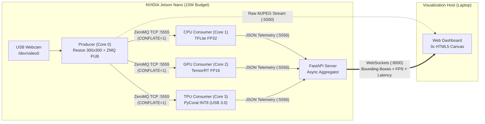
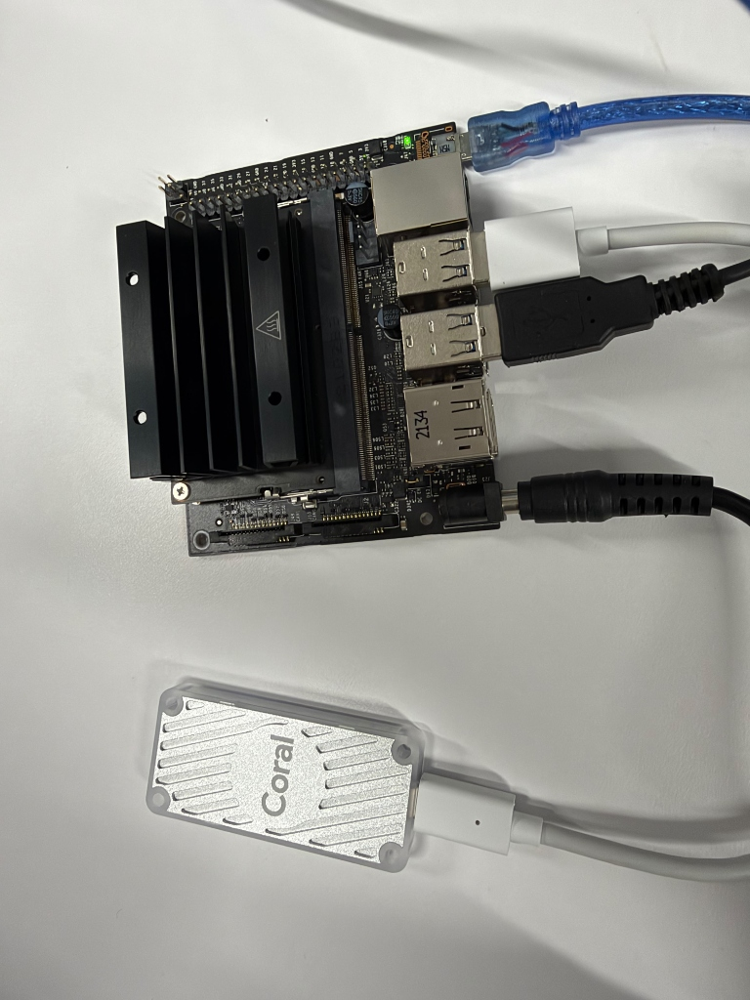

# Edge AI: Architectural Case Study — Real-Time CPU vs. GPU vs. TPU Benchmark

> **Interactive Whitepaper & Empirical Benchmark of Distributed Edge Inference Systems**  
> Comparative evaluation of silicon architectures (**ARM Cortex-A57 FP32**, **NVIDIA Maxwell FP16**, and **Google Coral Edge TPU INT8**) executing **MobileNetV2 SSD** object detection simultaneously under strict thermal and power envelopes (<15W).

---

## Table of Contents

1. [The Edge AI Dilemma](#1-the-edge-ai-dilemma)
2. [The Competitors: Silicon Architectures & Numerical Precision](#2-the-competitors-silicon-architectures--numerical-precision)
3. [Methodology & System Architecture ("Zero-Cheat" Design)](#3-methodology--system-architecture-zero-cheat-design)
4. [Hardware Requirements](#4-hardware-requirements)
5. [Project Structure](#5-project-structure)
6. [Empirical Results: Sequential Collapse vs. Dedicated Acceleration](#6-empirical-results-sequential-collapse-vs-dedicated-acceleration)
7. [Reproducibility & Deployment](#7-reproducibility--deployment)

---

## 1. The Edge AI Dilemma

In modern cloud data centers, deep learning models run on infrastructures with power budgets of hundreds of watts per accelerator (300W–700W) backed by industrial cooling systems. However, deploying computer vision to autonomous robots, drones, or industrial IoT devices (**Edge AI**) introduces the **Power and Latency Wall**:

- **Strict Power Envelope (<15W):** At the edge, the entire system budget—compute, memory, optical sensors, and I/O buses—is typically constrained between **5W and 15W**.
- **Real-Time Determinism:** Relying on cloud inference introduces unpredictable network latency, bandwidth saturation, and privacy risks. Safety-critical decisions must be computed locally within milliseconds.
- **The Von Neumann Bottleneck:** Continually shuttling data back and forth between DRAM and processor registers consumes significantly more energy and time than the arithmetic operation itself.

This repository documents and empirically demonstrates how three distinct hardware design philosophies address this dilemma by concurrently executing the **SSD MobileNetV2 (COCO)** object detection model on the exact same live video stream.

---

## 2. The Competitors: Silicon Architectures & Numerical Precision

To evaluate a Convolutional Neural Network (CNN) such as **MobileNetV2 SSD** (built upon depthwise separable convolutions), each processor adopts a fundamentally different paradigm regarding parallelism and numerical representation:

| Feature | CPU Consumer | GPU Consumer | TPU Consumer |
| :--- | :--- | :--- | :--- |
| **Processor / Silicon** | ARM Cortex-A57 (Quad-Core) | NVIDIA Maxwell (128 CUDA Cores) | Google Edge TPU (Dedicated ASIC) |
| **Compute Paradigm** | Sequential / Scalar Execution | Massive Parallelism (SIMT) | Matrix Systolic Array |
| **Numerical Precision** | **FP32** (32-bit Floating Point) | **FP16** (16-bit Half Precision) | **INT8** (8-bit Quantized Integer) |
| **Runtime / Engine** | `tflite-runtime` (Standard) | NVIDIA **TensorRT** (`.engine`) | **PyCoral** + `libedgetpu1-max` |
| **Resource Isolation** | `cpuset: "1"` (Isolated Core 1) | `cpuset: "2"` + CUDA Memory | `cpuset: "3"` + `/dev/bus/usb` Bus |

### 2.1. CPU: Classical Sequential Execution (FP32)
General-purpose CPUs are engineered for complex control flow, branch prediction, and low-latency sequential instruction execution. When evaluating millions of Multiply-Accumulate (*MAC*) operations in standard 32-bit floating-point (**FP32**), the Arithmetic Logic Unit (ALU) must fetch instructions, decode them, and repeatedly traverse the L1/L2 cache hierarchy and system RAM. This immediately saturates the assigned core.

### 2.2. GPU: Brute-Force Parallelism (FP16)
The Jetson Nano's Maxwell GPU trades complex control logic for **128 CUDA cores** governed by a **SIMT** (*Single Instruction, Multiple Threads*) architecture. Using **NVIDIA TensorRT**, the computational graph is optimized by fusing convolutional, activation, and normalization layers, while downcasting precision to **FP16** (16-bit floating point). This doubles effective memory bandwidth and computes thousands of pixels and convolutional filters concurrently.

### 2.3. TPU: Domain-Specific Systolic Array (INT8)
The **Google Coral USB Accelerator** integrates an **ASIC** (*Application-Specific Integrated Circuit*) purpose-built for **INT8** (8-bit quantized integer) linear algebra. Unlike CPUs and GPUs, it employs a two-dimensional **Systolic Array** of MAC units:
1. Quantized weights are pre-loaded directly into the physical matrix without cycling through intermediate registers on every clock tick.
2. Input activations flow through the mesh like a rhythmic wave (hence *systolic*), passing partial sums directly to adjacent processing elements without accessing DRAM.
3. Operating on 8-bit integers rather than 32-bit floats reduces memory footprint by **75%**, achieving up to **4 TOPS** (*Tera Operations Per Second*) while drawing only **~2W**.

---

## 3. Methodology & System Architecture ("Zero-Cheat" Design)

Many Edge AI benchmarks suffer from skewed measurements caused by OS scheduler contention, camera I/O locks, or the computational overhead of rendering bounding boxes onto video frames. To ensure **scientific rigor and strict fairness**, this project implements a distributed microservices architecture orchestrated via **Docker Compose**:



### 3.1. Strict Core Isolation (`CPU Pinning`)
The Jetson Nano's ARM Cortex-A57 processor features 4 physical cores. To prevent the Linux Completely Fair Scheduler (*CFS*) from introducing context-switching overhead or allowing one container to starve another of clock cycles, each microservice is hardware-pinned to an exclusive core via the `cpuset` directive in [`docker-compose.yml`](file:///Users/mangelhc/Documents/edge-ai-demo/docker-compose.yml):
- **Core 0 (`cpuset: "0"`):** Dedicated exclusively to the **Producer** (V4L2 camera capture, `300x300` resizing, and ZeroMQ publishing).
- **Core 1 (`cpuset: "1"`):** Dedicated to the **CPU Consumer** (pure sequential inference).
- **Core 2 (`cpuset: "2"`):** Dedicated to the **GPU Consumer** (host thread management and CUDA/TensorRT kernel dispatch).
- **Core 3 (`cpuset: "3"`):** Dedicated to the **TPU Consumer** (high-speed USB 3.0 communication with the Coral ASIC).

### 3.2. In-Memory Transport with ZeroMQ & `CONFLATE` Policy
A physical webcam (`/dev/video0`) cannot be locked simultaneously by three separate processes. The **Producer** container captures each frame once, resizes it to `300x300` pixels, and broadcasts it in RAM via a `zmq.PUB` socket (`tcp://*:5555`).

Because the **CPU Consumer** is orders of magnitude slower than both the camera capture rate and the GPU/TPU accelerators, a standard FIFO queue would accumulate hundreds of stale frames in RAM (*bufferbloat*), causing multi-second visual lag. To prevent this, every consumer explicitly enables the `zmq.CONFLATE` socket option:

```python
frame_subscriber.setsockopt(zmq.CONFLATE, 1)
```

With `zmq.CONFLATE` enabled, the subscriber's receive buffer retains **only the most recent frame**, atomically discarding intermediate frames that the processor could not consume in time. Consequently, all three architectures always evaluate the exact present instant in strict real time.

### 3.3. Principle of Graphical Decoupling
Rendering video, rasterizing fonts, and drawing bounding boxes via OpenCV (`cv2.rectangle` / `cv2.putText`) on the Jetson Nano would consume valuable CPU/GPU cycles and thermal headroom, contaminating pure inference metrics.

To eliminate this bias, the system enforces **Graphical Decoupling**:
1. Consumer nodes **never draw pixels**. They only compute bounding box coordinates (`left`, `top`, `right`, `bottom`), detected class labels, **FPS**, and **latency (ms)**, serializing them into an ultra-lightweight JSON payload published over ZeroMQ to port `5556`.
2. The **Server** container (`FastAPI` + `Uvicorn`) ingests this telemetry stream non-blockingly (`zmq.NOBLOCK`) and broadcasts it in real time via **WebSockets** (`/ws`) to an external **Visualization Host** (laptop).
3. The host browser receives the clean MJPEG video stream from port `5000` in parallel and overlays a transparent **HTML5 `<canvas>`** on top of each column, offloading 100% of the graphical rendering workload to the laptop's GPU.

---

## 4. Hardware Requirements

This architectural benchmark was built and validated on the following physical topology:

- **Primary Edge Compute Node:**
  - **NVIDIA Jetson Nano Developer Kit (4GB RAM)** running NVIDIA JetPack 4.6 (L4T R32.7.1).
  - **Integrated CPU:** Quad-Core ARM Cortex-A57 MPCore @ 1.43 GHz (64-bit).
  - **Integrated GPU:** NVIDIA Maxwell architecture with 128 CUDA cores.
  - **Power Supply:** 5V / 4A DC barrel jack (Power mode locked to `MAXN` - 10W/15W).
- **External Neural Accelerator (TPU):**
  - **Google Coral USB Accelerator** (Edge TPU ASIC) connected via a high-speed **USB 3.0** port on the Jetson Nano (configured with the maximum clock frequency runtime `libedgetpu1-max`).
- **Optical Sensor:**
  - Standard V4L2-compatible USB Webcam mapped to `/dev/video0` (capturing at `640x480` @ 30 FPS, normalized by the producer to `300x300`).
- **Visualization Host (Remote Client):**
  - Any PC or Laptop connected over the local network (or via direct USB-Ethernet bridge at `192.168.55.1`) running a modern web browser with HTML5 Canvas and WebSocket support.

### Physical Hardware Setup


*Physical testbed: NVIDIA Jetson Nano Developer Kit connected via USB 3.0 to the Google Coral Edge TPU Accelerator, USB Webcam (`/dev/video0`), and USB-Ethernet bridge to the Visualization Host.*

---

## 5. Project Structure

```text
edge-ai-demo/
├── docker-compose.yml              # Microservice orchestrator, hardware device mapping, and CPU Pinning (cpuset)
├── producer/
│   ├── Dockerfile                  # Lightweight environment with OpenCV Headless, PyZMQ, and Flask
│   └── producer.py                 # Captures /dev/video0, resizes to 300x300, and publishes via ZeroMQ + MJPEG
├── cpu_consumer/
│   ├── Dockerfile                  # ARM environment with standard tflite-runtime (no hardware delegates)
│   ├── cpu_inference.py            # Sequential inference on Core 1 with latency profiling and CONFLATE
│   ├── detect.tflite               # Standard MobileNetV2 SSD model for CPU execution
│   └── coco_labels.txt             # MS COCO dataset label dictionary
├── gpu_consumer/
│   ├── Dockerfile                  # Based on dustynv/jetson-inference:r32.7.1 with CUDA and TensorRT support
│   └── gpu_inference.py            # Parallel FP16 inference on Core 2 using shared CUDA memory
├── tpu_consumer/
│   ├── Dockerfile                  # Ubuntu 20.04 with static libedgetpu1-max runtime and PyCoral API
│   ├── tpu_inference.py            # INT8 systolic array inference from Core 3 over USB 3.0
│   ├── ssd_mobilenet_v2_coco_quant_postprocess_edgetpu.tflite  # Model compiled for the Edge TPU ASIC
│   └── coco_labels.txt             # MS COCO dataset label dictionary
├── models/
│   ├── mobilenet_v2.onnx           # Intermediate model representation and network manifests for TensorRT
│   └── ssd_coco_labels.txt         # Base label mapping for the GPU inference engine
└── server/
    ├── Dockerfile                  # Asynchronous environment with FastAPI, Uvicorn, WebSockets, and PyZMQ
    └── main.py                     # ZeroMQ -> WebSockets bridge and 3-column HTML5 Canvas Dashboard server
```

---

## 6. Empirical Results: Sequential Collapse vs. Dedicated Acceleration

When running all three inference engines simultaneously against a dynamic real-time scene, the architectural divergence becomes immediately apparent on the telemetry dashboard:


*(Placeholder reserved for live 3-column Dashboard screen recording or GIF: `assets/demo.gif`)*

### Analysis of Observed Behavior

| Empirical Metric | ARM CPU (Core 1 - FP32) | NVIDIA GPU (Core 2 - FP16) | Google Coral TPU (Core 3 - INT8) |
| :--- | :---: | :---: | :---: |
| **Per-Frame Latency** | ~180 ms – 250+ ms | ~22 ms – 35 ms | **~8 ms – 14 ms** |
| **Sustained Throughput (FPS)** | ~4 – 5 FPS | ~28 – 45 FPS | **~70 – 100+ FPS** |
| **Visual Bounding Box Behavior** | **Sequential Collapse** (Severe stuttering and visible lag behind moving targets) | Smooth real-time tracking | **Instantaneous tracking** tightly locked to object contours |
| **Relative Energy Efficiency** | Low (Core pinned at 100% thermal load) | Medium-High (Shared SoC power budget) | **Optimal** (~2W on dedicated off-SoC silicon) |

1. **"Sequential Collapse" on the CPU (Red Column):**  
   Isolated on a single Cortex-A57 core, the CPU requires over **200 ms** to complete a single forward pass of MobileNetV2 SSD. Thanks to `zmq.CONFLATE`, historical lag does not accumulate, but the red bounding boxes update only ~4 to 5 times per second—producing a stroboscopic effect incapable of tracking fast motion.
2. **GPU Brute-Force Parallelism with TensorRT (Green Column):**  
   By compiling the network into an **FP16** `.engine` plan, the 128 CUDA cores of the Maxwell architecture drive inference latency below the human persistence-of-vision threshold (~25–30 ms), delivering smooth full-motion video tracking (~30+ FPS).
3. **Systolic Array Supremacy on the TPU (Cyan Column):**  
   The **Google Coral Edge TPU** executes the **INT8** quantized graph in roughly **~10 ms per frame**, easily surpassing the native capture rate of the USB webcam itself. Furthermore, offloading matrix algebra to an external ASIC over USB 3.0 completely frees the Jetson Nano's SoC thermal and memory bandwidth budgets.

---

## 7. Reproducibility & Deployment

If you have access to the hardware specified in [Section 4](#4-hardware-requirements), you can launch the entire distributed architecture with a single command on the Jetson Nano:

```bash
# 1. Clone the repository on the NVIDIA Jetson Nano
git clone https://github.com/TheSoftwareDesignLab/GPU-TPU-demo.git
cd GPU-TPU-demo

# 2. Build and start all 5 containers with hardware core isolation
sudo docker-compose up --build
```

Once the containers are running and TensorRT finishes compiling the initial `.engine` file, open a web browser on your **Visualization Host (Laptop)** and navigate to:

```text
http://192.168.55.1:8000
```
*(Replace `192.168.55.1` with your Jetson Nano's local IP address if connected via a standard LAN Wi-Fi/Ethernet router).*

---

**Authorship & Academic Purpose:**  
This repository was developed as an empirical demonstration of computer architecture, parallel computing, and low-latency distributed embedded systems for Edge AI.
